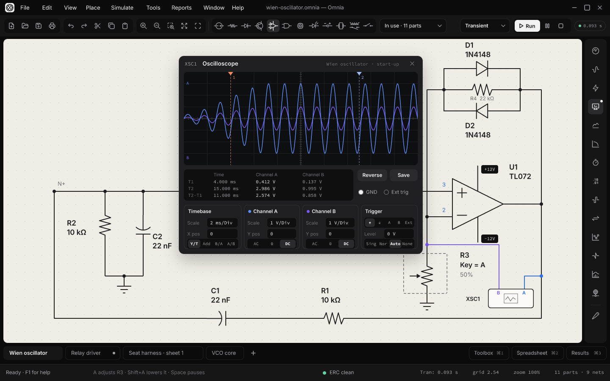

# Omnia

Schematic capture and simulation, in the spirit of Multisim, rebuilt for today. The app will be written in Rust with GPUI.
This repository currently holds the design work: FigCraft mockups, brand assets and the generators that build them.



## Contents

| Path | What it is |
| --- | --- |
| `omnia.figcraft` | FigCraft document: Workspace, Home and First boot screens in the Graphite and Gray themes, the Mark component, and the logo and wordmark boards |
| `*.png` | Exports of each screen and board |
| `brand/` | The Omnia mark, the globe-O wordmark (Asimovian) and app icons as SVG |
| `build-omnia.mjs` | Generates the screens (the FigCraft command script) |
| `build-logo-*.mjs`, `build-wordmark*.mjs`, `build-brand-svg.mjs` | Generate the logo boards, the wordmark boards and the brand SVGs |
| `symbols.mjs` | Loads the vendored schematic symbols and icons and places them as vector paths |
| `canvas-plan-prompt.md` | Planning brief for the infinite-canvas workspace (performance budgets and design requirements) |
| `vendor/` | Third-party symbols, icons and font; see `THIRD_PARTY.md` |

## Rebuilding

```sh
npm install
node build-omnia.mjs          # writes capture4.json
figcraft-cli run --in <base>.figcraft --out omnia.figcraft capture4.json   # base = a file with the Theme tokens and the Mark component
node build-brand-svg.mjs      # rewrites brand/*.svg
```

## Design

- The themes are Graphite (dark) and Gray (light). Every colour comes from a design token.
- The UI is set in Inter, with values and designators in Source Code Pro. The wordmark is outlined Asimovian with the Lissajous globe as its O.
- Schematic symbols come from Chris Pikul's electronic-symbols (IEEE and IEC); UI icons come from Tabler Icons.
- The sidebar appears only on the Home screen. The workspace has a menu bar, toolbars, a full-width sheet and an instruments strip.
- Simulators: ngspice is bundled; RIS-C (a Rust SPICE engine) is available as a preview.

## Licences

Third-party assets keep their own licences (MIT, and SIL OFL 1.1 for Asimovian); see `THIRD_PARTY.md`.
