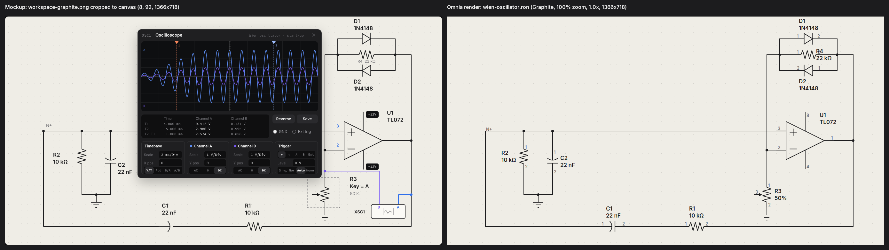

# T3.3 — Wien oscillator fixture (H2 review)

Side-by-side comparison of the mockup sheet (`design/build-omnia.mjs` lines 159–234,
`design/mockups/workspace-graphite.png` cropped to `(8, 92, 1366, 718)`) against Omnia's
100% zoom render of [wien-oscillator.ron](../../tests/golden/wien-oscillator.ron).

Individual images (both `1366 × 718` at 100% zoom, 1.0× scale factor):
- Mockup crop: [mockup-sheet.png](T3.3/mockup-sheet.png)
- Omnia render (Graphite, 1.0×): [wien-oscillator-100.png](T3.3/wien-oscillator-100.png)

## Render environment

- **Machine**: Windows development laptop (non-reference; golden images render on Windows per `AGENTS.md`, since Linux has no `render_to_image`).
- **OS**: Microsoft Windows 11 Home `10.0.26200`
- **CPU**: Intel Core i7-14650HX
- **GPU**: Intel UHD Graphics (driver `32.0.101.7088`, active adapter on primary display `1920 × 1200 @ 165 Hz`, 125% desktop scale); NVIDIA GeForce RTX 5060 Laptop GPU (driver `32.0.15.9191`, secondary display `1920 × 1080 @ 60 Hz`) also installed.
- **Power / plan**: AC (`100%`), `Silent` power plan
- **Golden harness**: `omnia-golden` (`tests/golden/tests/sheet.rs`), hidden window `render_to_image` at overridden scale factors `1.0`, `1.25` and `1.5` (`1366 × 718`, `1708 × 898`, `2049 × 1077`), both `GRAPHITE` and `GRAY` themes. `GRAPHITE` and `GRAY` outputs are byte-identical because all rendered canvas tokens (`stage/paper`, `stage/grid`, `stage/ink`, `stage/ink-secondary`) are currently identical across both themes.

## Fixture summary

`tests/golden/wien-oscillator.ron` was built through `Doc::apply` (`PlacePart`, `AddWires`, `AddLabel`) using `omnia-symbols` pin/bounds definitions and saved via `Doc::save` (RON v2):

- **Coordinate mapping**: `20 px = GRID_NM (2,540,000 nm)` (`1 px = 127,000 nm`). World origin is shifted by `(-690, -370)` px from the mockup's `(0, 0)` canvas origin, with camera center at `(-0.35, -0.55)` grid steps (`(-889,000, -1,397,000)` nm) for the `1366 × 718` viewport at `zoom = 1.0`. This maps every mockup coordinate `(mx, my)` to exact logical screen pixel `(mx, my)` and aligns every mockup grid dot `(10 + 20k, 10 + 20m)` with a world `GRID_NM` lattice point.
- **Contents**: 11 parts (`U1`, `D1`, `R4`, `D2`, `R3`, `R1`, `C1`, `R2`, `C2`, and two `Ground-COM-General` symbols), 31 normal-form wire segments (split at junctions and pins by `AddWires`), 1 net label (`N+` at `NP = (120, 360)`), 7 junctions, 9 nets.

## Visible differences

### 1. Intentionally omitted non-canvas items (per T3.3)
- **Floating oscilloscope window** (`XSC1 · Oscilloscope`, covering the middle of the sheet in the mockup) is omitted; floating instrument frames belong to `T7.3` / `U4.1` / `U5.5`.
- **On-sheet scope symbol and probes** (`XSC1` box/trace/labels, blue `XSC1 A` and purple `XSC1 B` probe wires, and their coloured dots at `(1270, 560)` and `(1000, 486)`) are omitted; instrument symbols are not canvas items yet.
- **Op-amp supply tags** (`+12V` and `−12V` dark pills beside `U1` pins 8 and 4) are omitted; supply tags are not canvas items yet.
- **Interactive potentiometer affordances** (dashed `R3 interactive` box around `R3` and the `Key = A` hotkey line) are omitted; `Part` currently holds one `value` field, set here to `"50%"`.
- **Rounded canvas corners** (`cornerRadius: 10` on the mockup canvas frame against `bg/backdrop`) are omitted; `SheetView` fills its rectangular viewport and rounded framing belongs to the workspace shell (`U1.7`).

### 2. Label placement and typography (T3.1 / K8 vs hand-placed mockup text)
- **`R4` label overlap and style (notable)**: The mockup hand-places `"R4  22 kΩ"` as a single 12 px Medium `stage/ink-secondary` line below `R4`. Under `K8`/`Q3` (`T3.1`), Omnia renders all part labels as stacked 17 px SemiBold `stage/ink` lines, and T3.1's automatic clearance scorer places `R4 / 22 kΩ` to the right of `R4` where `"R4"` overlaps pin number `2` and the two-line block straddles the right tap wire `(1170, 120)–(1220, 120)`.
- **Automatic part-label offsets**: T3.1 derives each part label anchor from symbol bounds and local clearance rather than per-part manual offsets, shifting several blocks slightly relative to the mockup:
  - `D1 / 1N4148` and `D2 / 1N4148`: shifted ~10 px right and closer to the diode bodies.
  - `U1 / TL072`: shifted ~26 px left, closer to the upper-right edge of the op-amp triangle (no `+12V` pill to clear).
  - `R3 / 50%`: placed immediately right of `R3`'s body rather than outside the omitted dashed interactive box.
  - `R1 / 10 kΩ` and `C1 / 22 nF`: shifted ~6–10 px down closer to the symbols and slightly right.
  - `R2 / 10 kΩ`: shifted ~20 px right (closer to `R2`) and slightly up.
  - `C2 / 22 nF`: shifted ~14 px up (vertically centered beside `C2`) and slightly left.
- **`N+` net label position**: `N+` is attached to `NP = (120, 360)` so `Doc::connectivity` names the positive-input net `N+` (matching the mockup's `11 parts · 9 nets`). T3.1 paints `NetLabel` with baseline at `anchor.y` and `x = anchor.x + 2 px`, so `N+` sits directly on top of the horizontal `to +` wire (`baseline y = 360`, `x = 122`), whereas the mockup placed it higher and slightly further right (`top y = 334`, `x = 128`, ~13 px above the wire).
- **Pin numbers**: The mockup only draws `U1` pins `3` and `2`, coloured blue (`#2F6FEB`). Per `T3.1`/`K8`, Omnia draws pin numbers for **every** multi-pin symbol (`U1`: `3, 2, 1, 8, 4`; `D1`/`D2`/`R1`/`R2`/`R4`/`C1`/`C2`: `1, 2`; `R3`: `1, 2, 3`) in `stage/ink-secondary` (`#6B6B70`) and omits them on single-pin grounds. On `U1`, pins `3` and `2` sit ~8–10 px lower/closer to the input leads than in the mockup.

### 3. Junction dots (INV3)
- **No dot at corner `NP = (120, 360)`**: The mockup drew a manual dot at `NP`, where only two wires (`C1-NP` and `to +`) meet in a 90° bend. Omnia places junction dots strictly where 3 or more ends meet (`INV3`), leaving `NP` as a clean corner.
- All 7 real T/cross junctions (`(240, 360)`, `(330, 360)`, `(285, 560)`, `NM = (1000, 420)`, `(1040, 120)`, `(1220, 120)`, `OUT = (1270, 390)`) match the mockup's positions and `8 px` diameter.

### 4. Grid dots and stroke rendering
- **Grid dots**: Paper (`#EFEDE6`) and dot core (`(207, 205, 199)`) match pixel-for-pixel at `(10 + 20k, 10 + 20m)`. At 1.0× scale, `SheetView` snaps each `1.2 px` dot (`GRID_DOT_PX`) to an exact `1 × 1` device pixel (`D5`), whereas the mockup anti-aliased `1.2 × 1.2` vector squares into faint adjacent pixels.
- **Wires and symbols**: Every wire and symbol centerline aligns to 0 px against the mockup. `SheetView` renders wires as whole-device-pixel quads (`2 px` at 1.0× vs the mockup's `1.8 px` anti-aliased stroke) and symbols via resvg alpha-mask sprites using the vendor SVG caps/joins (`butt`/`miter` vs the mockup's `round`/`round`), producing minor sub-pixel differences at corners and tips.

### 5. Off-lattice coordinates inherited from `build-omnia.mjs` (H2 note)
Two parts in `build-omnia.mjs` sit off the `1.27 mm` (`10 px`) `PIN_LATTICE_NM` lattice:
- `C2` at `(330, 456)` px (`y = 456`, 4 px above `460`).
- Left `GND` at `(285, 560)` px (`x = 285`, exact midpoint of the `240–330` ground bus).

The fixture currently keeps exact `build-omnia.mjs` coordinates so the render matches `workspace-graphite.png` pixel-for-pixel. `Doc::load` and `SheetView` accept them cleanly, though `Doc::assert_normal_form` (`WINV3`) requires every wire end on `PIN_LATTICE_NM`.

## H2 decision (2026-11-22)

- **Owner approval**: Approved as-is by the owner on 2026-11-22 (in the T3.3 task review thread). The 6 rendered `wien-oscillator-{graphite,gray}-{100,125,150}.png` images are committed as the T3.3 goldens.
- **Coordinates (`WINV3` caveat)**: Kept exact `build-omnia.mjs` coordinates (`C2` at `y = 456`, left `GND` at `x = 285`) so the visual fixture matches `workspace-graphite.png` pixel-for-pixel. Because those two points sit off `PIN_LATTICE_NM`, future tasks that call `Doc::assert_normal_form` (`WINV3`) or run `Move`/`DragSegment` on `wien-oscillator.ron` will encounter off-lattice wire ends.
- **Follow-ups logged**: `R4 / 22 kΩ` automatic label overlap with pin `2` and the right tap wire, and `N+` net-label baseline contact with the horizontal wire (`crates/omnia-canvas/src/sheet/text.rs`).
